# Bunyan — data model (ERD)

The knowledge base (`js/knowledge/`, read-only leaf data) and the user's data (`js/state.js`, per profile, on device) in one model, with the points where they join marked **JOIN**.

Knowledge entities are named for the spec's vocabulary; each note says which file and export holds it. User entities are named for what `state.js` actually stores.

```mermaid
erDiagram
    %% ---------------- knowledge (js/knowledge) ----------------
    PHASE ||--|| ACUTE_VARIABLE_SET : "has (phases.js PHASE_VARIABLES)"
    PHASE }o--|| LEVEL : "belongs to (phases.js LEVELS)"
    PHASE ||--o{ PHASE : "precedes / follows"
    GOAL_PLAN }o--|{ PHASE : "routes through (phases.js GOAL_PLANS)"
    ACUTE_VARIABLE_SET }o--|| ADAPTATION : "matches (acute-variables.js BY_ADAPTATION)"
    TEMPLATE_SECTION ||--o{ ACUTE_VARIABLE_SET : "parameterised per phase"
    CORRECTIVE_STAGE ||--|| TEMPLATE_SECTION : "is performed in (corrective.js SEQUENCE)"
    CORRECTIVE_STAGE ||--o{ TECHNIQUE : "uses (corrective.js TECHNIQUES)"
    ASSESSMENT ||--o{ FINDING : "observes (assessments.js ASSESSMENTS)"
    FINDING }o--|| IMBALANCE_PATTERN : "indicates (imbalances.js MOVEMENT_FAULTS / PATTERNS)"
    IMBALANCE_PATTERN }o--|{ MUSCLE : "overactive"
    IMBALANCE_PATTERN }o--|{ MUSCLE : "underactive"
    FINDING }o--|{ MUSCLE : "overactive / underactive"
    MUSCLE }o--o| MUSCLE_GROUP : "maps to (anatomy.js MUSCLE_MAP)"
    TECHNIQUE ||--o{ STRETCH : "lists (target muscles)"
    STRETCH }o--|{ MUSCLE : "targets"
    EXERCISE }o--|| MUSCLE_GROUP : "primary tag m"
    EXERCISE }o--o{ MUSCLE_GROUP : "secondary tags x"
    EXERCISE ||--o| CUE : "has (cues.js CUES, key = exercise id)"
    PROGRESSION_LEVEL }o--o{ EXERCISE : "names (core/balance/plyometrics PROGRESSION)"
    PROGRESSION_EXERCISE }o--o{ MUSCLE : "targets (only where the book names them)"
    PROGRESSION_LEVEL ||--o{ PROGRESSION_EXERCISE : "lists (core.js / balance.js EXERCISES)"
    CONDITION ||--o{ SCOPE_RULE : "gated by (scope.js RULES)"
    CONDITION ||--|| GUIDELINE : "has (conditions.js guidelines)"
    NUTRITION_RULE }o--o| SCOPE_RULE : "bounded by"
    SCREENING ||--o{ SCOPE_RULE : "triggers (assessments.js SCREENING.parq.logic)"

    %% ---------------- user data (js/state.js, per profile) ----------------
    PROFILE ||--o{ SESSION : "S.sessions"
    SESSION ||--|{ ENTRY : "entries"
    ENTRY ||--o{ SET : "sets"
    PROFILE ||--o{ DAY : "S.days[date]"
    DAY ||--o{ MEAL : "meals"
    MEAL ||--o{ FOOD_ITEM : "items"
    PROFILE ||--o{ BODY_WEIGHT : "S.body"
    DAY ||--|| ACTIVITY_LOG : "water, steps, sleep, soreness, energy"
    PROFILE ||--o| PLAN : "S.myPlan"
    PROFILE ||--o| COACHING_STATE : "planned"
    PROFILE ||--o{ ASSESSMENT_RESULT : "planned"

    %% ---------------- JOIN points ----------------
    ENTRY }o--|| EXERCISE : "JOIN: entry.id → exercises.json i"
    PLAN }o--o| ACUTE_VARIABLE_SET : "JOIN: prescription derives from (spec 2.2; plan.js today)"
    COACHING_STATE }o--|| PHASE : "JOIN: current phase"
    ASSESSMENT_RESULT }o--|| ASSESSMENT : "JOIN: which test"
    ASSESSMENT_RESULT }o--o{ FINDING : "JOIN: what was seen"
    PROFILE }o--o{ CONDITION : "JOIN: declared at screening"
    DAY }o--o{ NUTRITION_RULE : "JOIN: targets (formulas.js targetKcal)"
```

## Cardinality notes

- One phase has exactly one variable set per template section (`PHASE_VARIABLES[phase]`). The same numbers are also indexed by adaptation (`BY_ADAPTATION`). Neither merges per-phase values into one range.
- A finding can implicate many muscles. A muscle maps to at most one library group, and five deep muscles map to none (`tag:null`).
- An exercise has at most one cue entry (two cues, ten words each).
- `COACHING_STATE` and `ASSESSMENT_RESULT` do not exist in `state.js` yet. They are the user-side half the coaching engine (spec §5) must add. They are drawn so the joins are visible now.

## The question the model must answer

> Given a user's assessment findings, which corrective exercises are prescribed, in which order, with what parameters?

1. `ASSESSMENT_RESULT` → `FINDING`s, e.g. OHSA "knees cave in", which is `imbalances.js MOVEMENT_FAULTS ohsa_knees_in`.
2. `FINDING` → overactive `[tensor fasciae latae, adductors]` and underactive `[gluteus maximus, gluteus medius, tibialis anterior, tibialis posterior]`.
3. `CORRECTIVE_STAGE` order from `corrective.js SEQUENCE`:
   - **inhibit:** SMR on the overactive muscles, 1–3 groups × at least 30 s.
   - **lengthen:** static stretch in phase 1 (1–3 × 30 s), active in phases 2–4, dynamic in phase 5, on the same muscles.
   - **activate:** core and balance exercises at the phase level for the underactive muscles (`PHASE_VARIABLES[phase].activation`).
   - **integrate:** resistance training of the patterns (`PHASE_VARIABLES[phase].resistance`).
4. Concrete exercises:
   - `STRETCH`es whose `target` holds an overactive muscle, e.g. `static_standing_tfl` and `static_standing_adductor`.
   - `PROGRESSION_LEVEL` exercises for activation.
   - Each `EXERCISE` joins its `CUE` by library id.
5. Gate: `SCOPE_RULE`s run first. Pain → refer, with no programming around it (`refer_pain_movement`). Any PAR-Q+ yes → clearance first.

Every step is a lookup on existing fields. Checked by running the query on the data (20 Oct): for "knees cave in" it returns SMR on TFL and adductors, three named stretches, then floor bridge, single-leg balance, single-leg RDL, step-up to balance and side tube walking for the glutes, each with phase-1 doses.

**Limit, stated plainly:** activation picks exercises by `targets`, and targets are recorded only where the book names the muscle. That covers the lower-body and core findings. For the upper-body findings (lower and middle trapezius, rhomboids, deep cervical flexors) the book names no activation exercise by muscle. The cobra is linked to them only through an `agentReading` (Bunyan's interpretation, labelled as such), and the tibialis muscles have no activation exercise at all. A complete copy of the book's missing appendix (gap 5) or a corrective-exercise source would close this.
