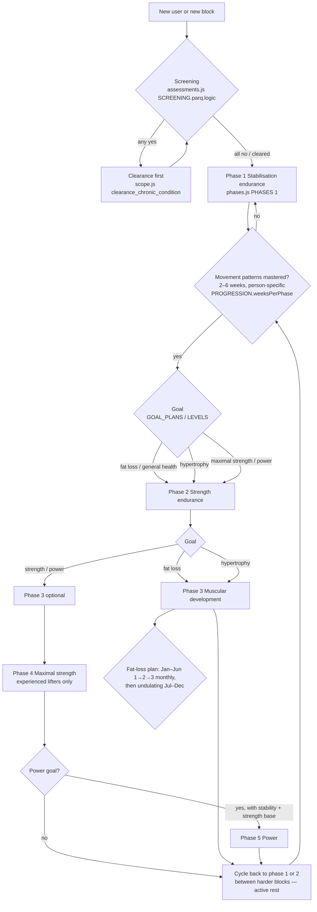
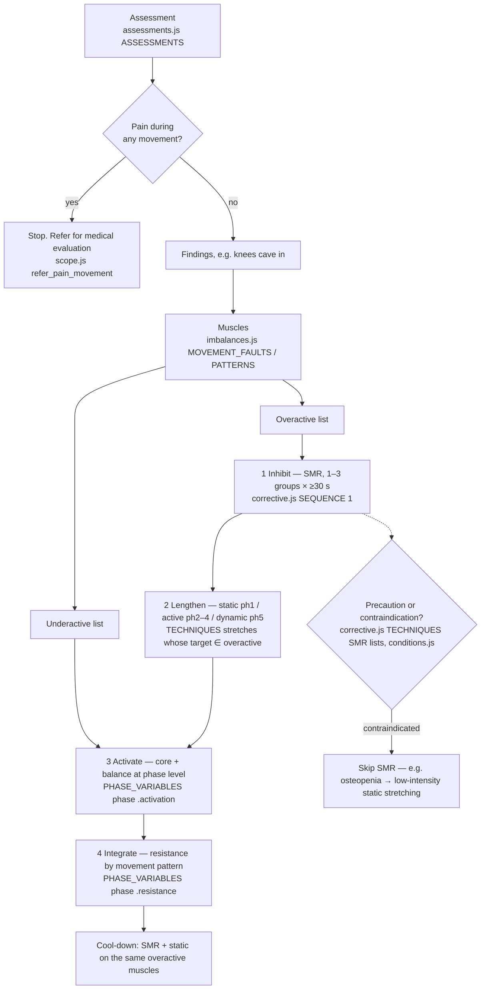
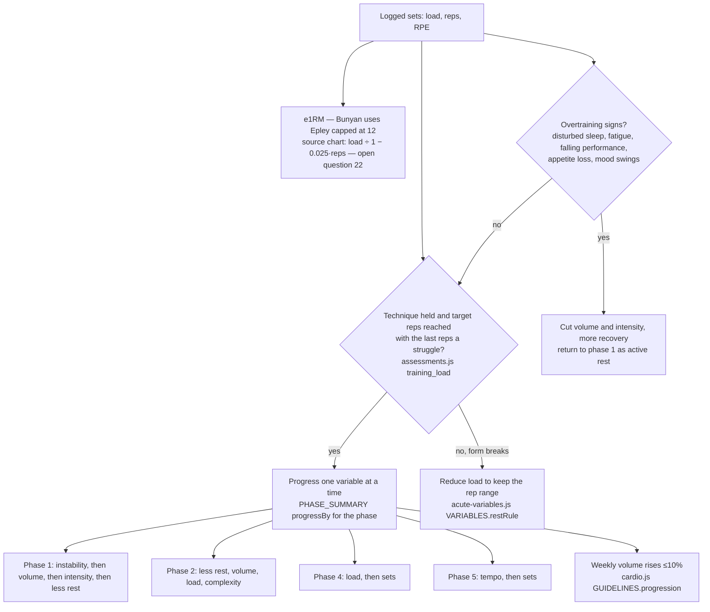
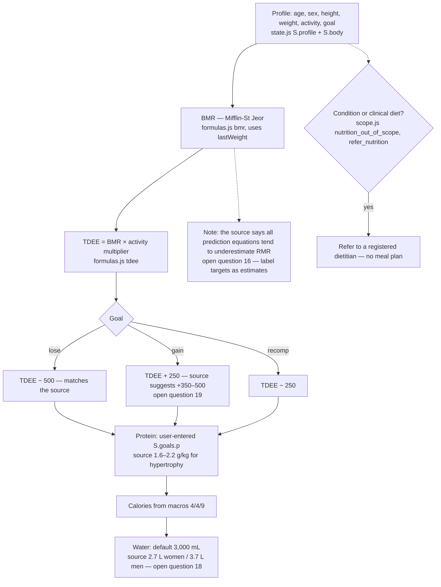

# Bunyan — decision flows

The four decisions the app makes, as the knowledge base defines them. Each node names the file and field it reads.

- Where the app already does something (nutrition targets, set progression), the flow shows the current code path *and* the source's view, with differences pointing to the open questions in the ingestion log.
- Nothing here has been wired into the app.

## 1. Phase selection and progression

## 2. Corrective prescription

## 3. Progression / deload

## 4. Nutrition target derivation

