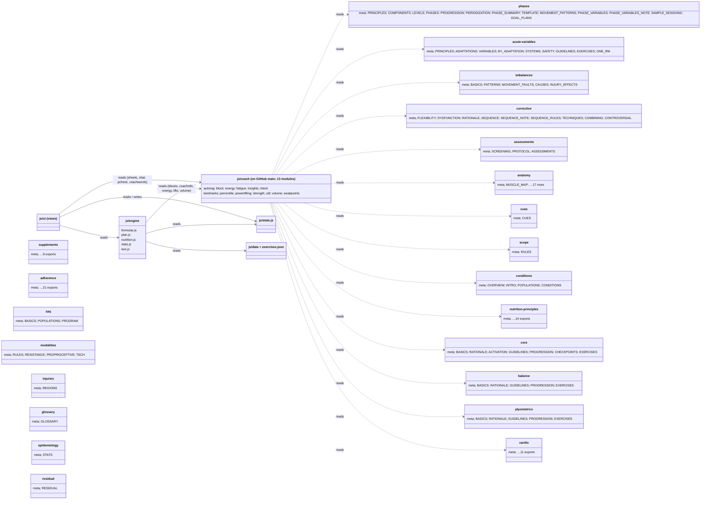

# Bunyan — module structure (UML)

What each module exports, what it depends on, and the direction of every dependency. Exports are copied from the files' `export {…}` lines (generated 20 Oct).

**The rule this diagram proves:** `js/knowledge/` depends on nothing. Every knowledge module has zero imports, no DOM access and no network calls (checked by `grep` for `import`, `fetch(`, `document.`, `window.`, `localStorage`: no matches). Cross-references between knowledge files are strings in comments and fields (e.g. `"see anatomy.js MUSCLE_MAP"`), not imports. So there are no arrows between them and no cycles are possible.

## Today vs planned

- **Today (GitHub `main`, checked in a clone on 20 Oct):** `js/coach/` exists with 13 modules. They import only each other: `insights` → fatigue, strength, autoreg, volume, weakpoints; `percentile` → powerlifting, weakpoints; `block` and `volume` → landmarks; most → util. There are no cycles. `js/engine/` (blocks, coachinfo, energy, lifts, volume) and the UI (sheets, chat, pcheck, coachwords) import `js/coach/`. **Nothing imports `js/knowledge/` yet.**
- **Planned:** `js/coach/` imports knowledge modules lazily with dynamic `import()` the first time a coaching feature opens. The dotted arrows above are those planned reads. Arrows still only point down: UI → engine → coach → knowledge. Knowledge points at nothing.
- **Note:** this folder (Downloads\Bunyan) predates `js/coach/`. The knowledge base was built here and is being imported into the repo on a branch.

## Weight

- Knowledge files: **600,833 bytes** (22 files, uncompressed).
- Nothing in the app loads them yet, so today's app weight is unchanged. Once wired, load per feature (e.g. only `corrective.js` + `imbalances.js` + `cues.js` for a corrective block), never all 22 at start-up.
